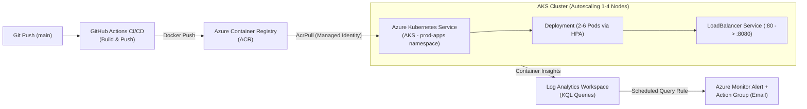

# AKS Modernization & Observability

End-to-end containerization, **Azure Kubernetes Service (AKS)** deployment, **CI/CD automation**, and **Azure Monitor / Log Analytics (KQL)** observability for a Node.js microservice.

## Architecture & CI/CD Flow



## Key Features
- **Containerized Microservice (`app/`):** Multi-stage Alpine `Dockerfile` running as a non-root user (`node`) with a built-in `/health` check and `/ready` probe.
- **Infrastructure as Code (`infra/`):** Bicep template provisioning **Log Analytics Workspace**, **ACR**, **AKS** (with node pool autoscaling and Container Insights enabled), **`AcrPull` RBAC** assignment, and a **KQL-based Pod Restart Alert** + Action Group.
- **Kubernetes Manifests (`k8s/`):** Dedicated `prod-apps` `Namespace`, `Deployment` (CPU/memory requests & limits, liveness/readiness probes, non-root `securityContext`), `LoadBalancer` `Service`, and `HorizontalPodAutoscaler` (`minReplicas: 2`, `maxReplicas: 6`, target CPU `70%`).
- **Observability (`monitoring/kql-queries.kql`):** Ready-to-use KQL queries for CrashLoopBackOff/pod restarts, `OOMKilled` containers, node CPU/memory performance, and error log filtering.

## Repository Structure

```text
├── .github/workflows/
│   └── ci-cd-aks.yml             # Build Docker -> Push ACR -> Deploy to AKS
├── app/
│   ├── Dockerfile                # Multi-stage non-root container image
│   ├── package.json
│   └── src/server.js             # HTTP microservice (/health, /ready, /)
├── infra/
│   ├── main.bicep                # AKS, ACR, Log Analytics, AcrPull RBAC & Alerts
│   └── parameters.dev.json
├── k8s/
│   ├── namespace.yaml
│   ├── deployment.yaml
│   ├── service.yaml
│   └── hpa.yaml
├── monitoring/
│   └── kql-queries.kql           # Log Analytics KQL troubleshooting queries
└── README.md
```

## Quick Start

### 1. Provision AKS, ACR & Monitoring
```bash
az group create --name rg-aksmod-dev --location centralindia
az deployment group create \
  --resource-group rg-aksmod-dev \
  --template-file infra/main.bicep \
  --parameters @infra/parameters.dev.json
```

### 2. Build & Push Image to ACR
```bash
ACR_NAME=$(az acr list -g rg-aksmod-dev --query "[0].name" -o tsv)
az acr build --registry $ACR_NAME --image aks-demo-service:latest ./app
```

### 3. Deploy to AKS
```bash
az aks get-credentials --resource-group rg-aksmod-dev --name aksmod-dev-aks
kubectl apply -f k8s/namespace.yaml
# Replace <ACR_LOGIN_SERVER> in k8s/deployment.yaml before applying
kubectl apply -f k8s/
```

### 4. Clean Up (Avoid Ongoing Cluster Charges)
```bash
az group delete --name rg-aksmod-dev --yes --no-wait
```
